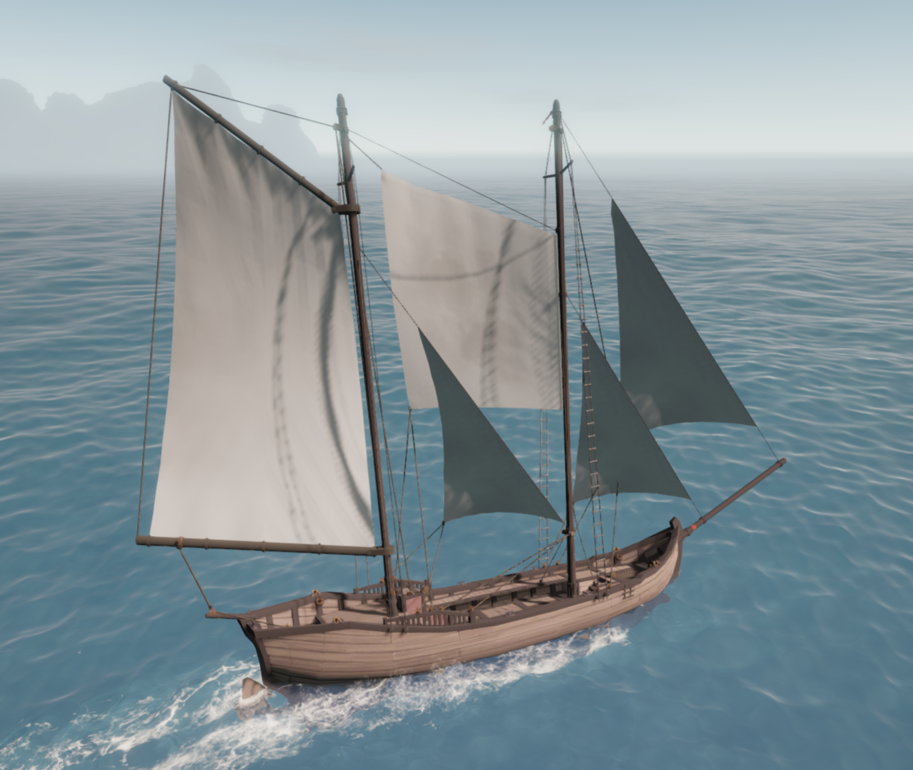
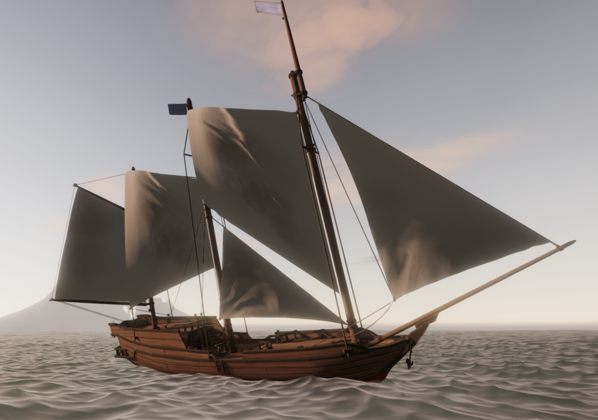
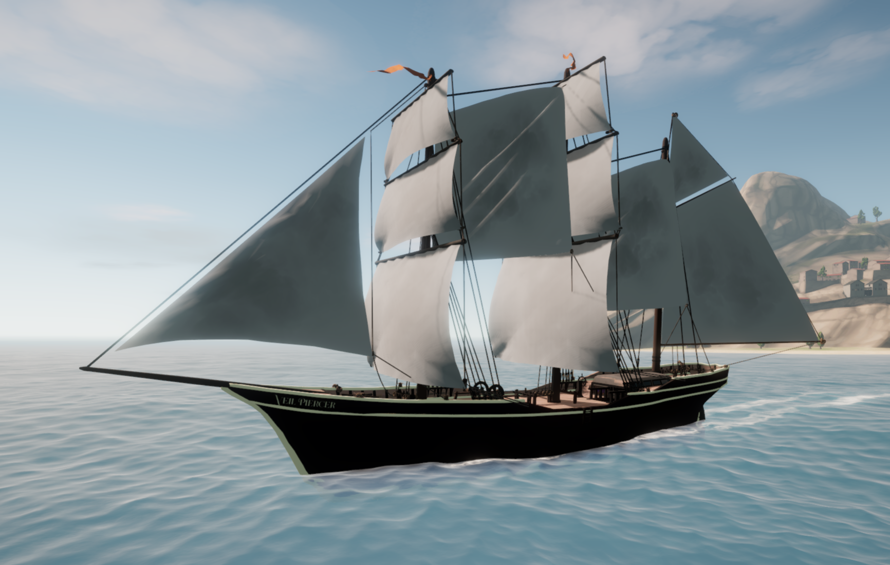
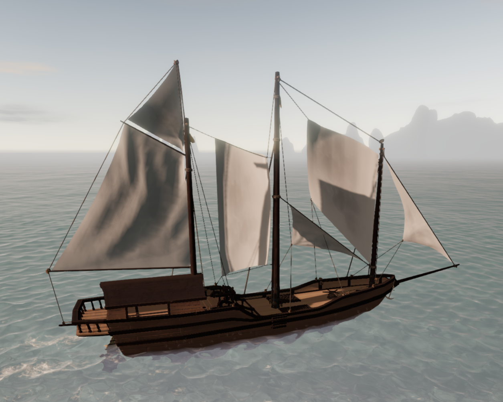
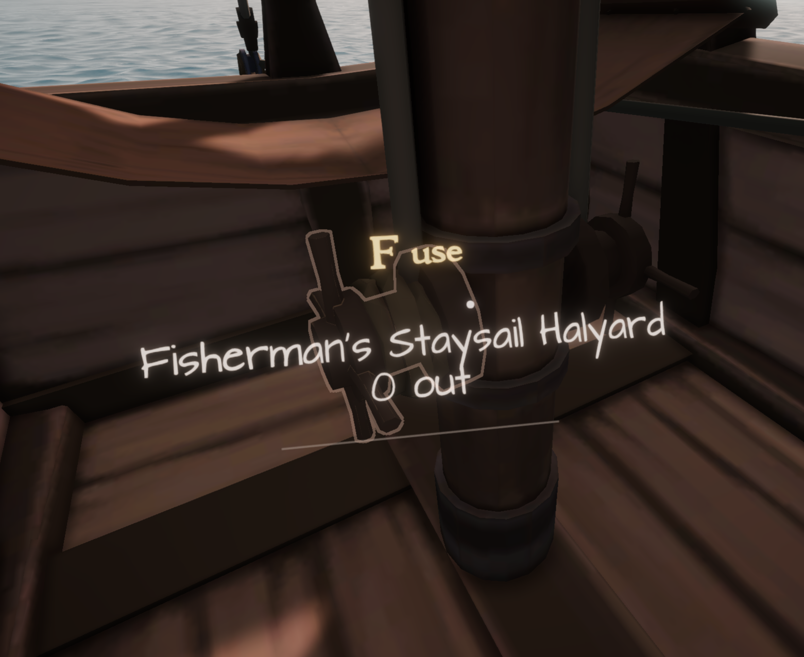
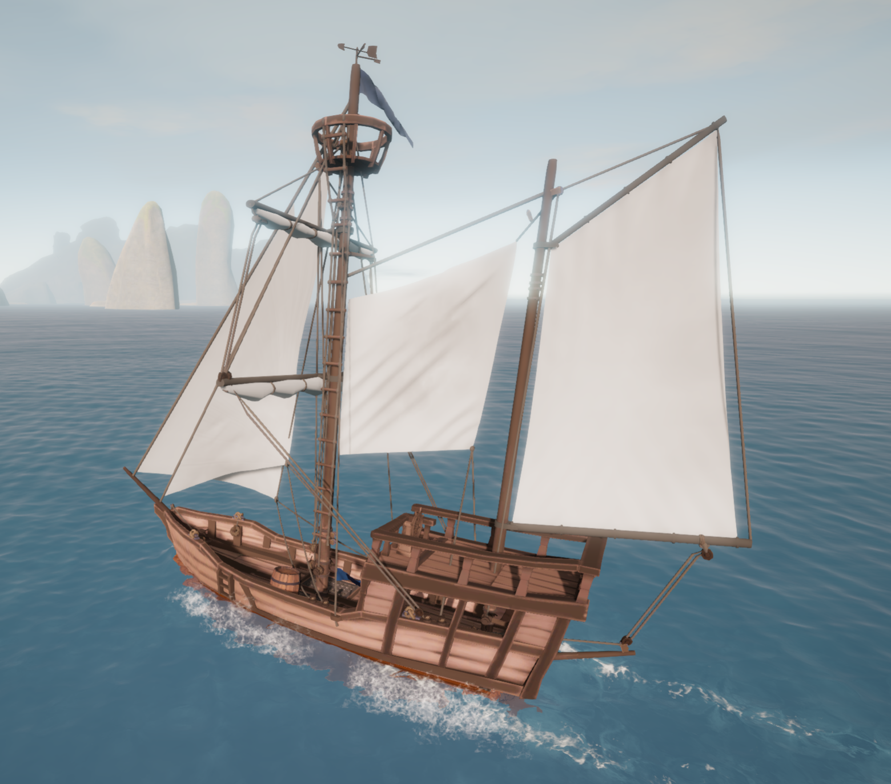

# MoreSailwindSails

## Overview

MoreSailwindSails adds two families of sails to Sailwind:

- **Fisherman's Staysails** — Mk.A, Mk.B and Mk.C cuts fitted to a Fisherman's
  Stay between two masts.
- **Fisherman's Flying Sails** — sails fitted directly to a physical mast, with
  a fitted mast behind it for support.

**Fisherman's Stays** provide the rigging mounts for the staysail family.

### Current versions

**Latest release:** 0.3.0\
**Development:** 0.4.0

See the [changelog](#changelog).

  
  
  
   
  
  
  

Select a screenshot to view it at full size. These show earlier versions;
current sails use plain cloth with your chosen color.

### What's included

| Sail or rigging               | What it adds                                                                                |
| ----------------------------- | ------------------------------------------------------------------------------------------- |
| **Fisherman's Stay**          | A high stay between two masts, with options for different mast and topmast combinations.    |
| **Fisherman's Staysail Mk.A** | A four-corner sail whose lower edge slopes downward toward the rear mast.                   |
| **Fisherman's Staysail Mk.B** | The same upper edge and controls as Mk.A, with a lower edge that is level on upright masts. |
| **Fisherman's Staysail Mk.C** | A 50% longer forward edge than Mk.A/B, with a lower edge rising toward the rear mast.       |
| **Fisherman's Flying Sail**   | A trapezoid sail fitted directly to a mast through the **Other** category.                  |

### Supported boats

Flying Sails and Fisherman's Staysails have support for the boats below.
Available fittings depend on your installed mods and chosen masts; not every
mast combination supports a sail or stay.

| Boats                                 | Requirements and fitting notes                                                                               |
| ------------------------------------- | ------------------------------------------------------------------------------------------------------------ |
| **Brig, Junk, Jong, Sanbuq, Baghala** | Stay options are available with the base game. Shipyard Expansion adds more mast combinations on some boats. |
| **Cog, Kakam, Dhow**                  | Current Fisherman's Stay options require parts supplied by Shipyard Expansion.                               |
| **Shroud**                            | Requires [Shattered Seas Expansion](https://github.com/TheOriginOfAllEvil/Shattered-Seas-Expansion).         |
| **Gloriana, Chronian, Caelanor**      | Requires OldChronian; support targets version 0.6.0.                                                         |

On the Dhow, one stay option covers both supported mainmast heights. Caelanor's
stay uses the aft mainmast position, not the Midmast alternative. Chronian's
main-to-mizzen Fisherman's Stay cannot be fitted alongside its Mizzen Royalstay.

**Leopard and Gallus are not supported.** Experimental spritsails are not
included in this version. Future Leopard compatibility is tracked in
[issue #33](https://github.com/sum-rock/MoreSailwindSails/issues/33).

## Usage

### Fitting a staysail

1. Open the shipyard's **rigging parts** and select **Fisherman's Stay** for the
   mast pair you want to use.
2. Choose the variant matching your fitted masts and topmasts.
3. Select that stay in the sail-fitting controls, open **Staysails**, and choose
   **Fisherman's Staysail Mk.A**, **Mk.B** or **Mk.C**.
4. Resize and position the sail with the normal shipyard controls, leaving
   clearance from the deck, aft mast and other rigging.
5. Complete the shipyard order.

**Mk.A, Mk.B and Mk.C fit only on Fisherman's Stays.** Each stay carries one
sail; these stays can also carry vanilla staysails. Supported three-masted boats
offer additional mast pairs.

All three cuts start with the same width. Mk.C's forward edge (the luff) is 50%
longer than Mk.A/B's and needs more room on the forward mast. Resize using the
controls available in your shipyard. The sail's top follows the stay, and its
lower edge tilts with the forward mast.

Remove a fitted sail before replacing or removing its stay. If you change a
supporting mast or add a topmast, choose a matching stay variant as part of the
shipyard changes.

### Using the Flying Sail

At a shipyard, select a **physical mast**, open **Other**, and choose
**Fisherman's Flying Sail**. It needs a supported fitted mast behind it.

Its own hoist winch raises it from the deck, and its port and starboard sheets
control the trim. Fully lowering it hides the sail. Leave clearance below the
aft supporting pulley when sizing and positioning it.

### Colors and controls

Both sail families start with plain white cloth and can be recolored at the
shipyard. With Shipyard Expansion 0.12.1 (and newer), texture cycling is
restricted to plain cloth; older saved patterned selections are changed to plain
cloth when loaded.

Controls use available mounting points on the boat. Some boats also have extra
positions for when the usual points are occupied. If no suitable position is
free, the affected controls stay hidden until a position becomes available.

SailInfo is optional. When installed, its hover labels identify Fisherman's
Flying Sails and Staysails; staysails also report their sheet angle.

## Requirements and installation

**Use at your own risk.** This mod is provided as-is, without warranty. I am not
responsible for damage, data loss, or other issues affecting your computer,
game, or save files from using this mod. Back up your saves before installing.

- Built against **Sailwind 0.39**
- **BepInEx 5**

**Optional mods:**

- **Shipyard Expansion 0.12.1** for additional rigging and shipyard controls.
  Starting with 0.3.0, it is no longer required to load MoreSailwindSails, but
  some boat fittings still need its parts (see
  [supported boats](#supported-boats)).
- **SailInfo** for control hover labels and sail information; integration was
  checked against version **1.2.1**.
- **Shattered Seas Expansion** or **OldChronian** for their respective boats.

1. Download `MoreSailwindSails.dll` from the
   [release page](https://github.com/sum-rock/MoreSailwindSails/releases).
2. Close Sailwind.
3. Place the DLL in `<Sailwind>/BepInEx/plugins/MoreSailwindSails/`, creating
   the folder if needed.
4. When updating, replace the old DLL and remove any duplicate copies.
5. Launch the game and visit a shipyard.

### Updating from 0.2.2

Back up your save before updating. Keep Shipyard Expansion installed for saves
that already use it: making it optional does not make its saved rigging safe to
remove. The same applies to mods that provide your boat.

Existing Fisherman's sail and stay selections are retained. If existing sails
show odd textures and patterns when you upgrade, they will be able to be fixed
(for free) when you visit a shipyard.

### If something is missing

- **No stay or sail option:** check the boat, installed mods and fitted masts.
  Staysails require a Fisherman's Stay; Flying Sails require a physical mast and
  a supported mast behind it.
- **A stay or mast cannot be removed:** remove its fitted sail first.
- **Missing winches:** other sails may occupy the available control positions.
  Check for competing sails on the same masts.

For a bug report, include the boat, fitted masts, mod versions, steps to
reproduce, a screenshot if useful, and `BepInEx/LogOutput.log`. Submit it
through the
[issue tracker](https://github.com/sum-rock/MoreSailwindSails/issues).

## Removing the mod

Before uninstalling, remove all sails and rigging added by MoreSailwindSails
(currently the Fisherman's sails and stays), then save your game. Remove fitted
sails before removing the stays or masts that support them.

## Changelog

### 0.3.0

- **Shipyard Expansion is now optional.** Supported base-game rigs can use
  Fisherman's sails and stays without it. The native shipyard gains page arrows
  for longer rigging lists; fittings that need missing mod parts stay
  unavailable.
- Added **Kakam and Dhow** support and **Gloriana, Chronian and Caelanor**
  support from OldChronian. Dhow uses one stay option for both supported
  mainmast heights.
- Added extra halyard mounting positions on **Sanbuq, Gloriana and Kakam**, and
  placed Kakam's sheet controls near the stern.
- **Flying Sail ropes now follow the game's 3D rope setting**, matching the
  rounded appearance of native ropes when enabled.
- Reworked all four sail meshes and their texture mapping. Sails use plain cloth
  with normal recoloring; SE texture selection is restricted to plain cloth to
  prevent mismatched sail patterns, including on older saved sails.
- Removed forced uniform scaling and the mod's rotation/flip restrictions on
  staysails, leaving those options to the installed shipyard controls.

Experimental spritsails developed between releases are not included in 0.3.0.

### 0.2.2

- Updated texture integration for **Shipyard Expansion 0.12.1**, fixing the
  missing-field exception that interrupted game loading.
- Requires **Shipyard Expansion 0.12.1**.

### 0.2.1

- **Completely reworked sheeting winch and halyard winch placement** for much
  more reasonable and consistent locations, using available native mounting
  points and respecting existing winch use.
- Fixed Fisherman's sail compatibility with **Shroud** from
  [Shattered Seas Expansion](https://github.com/TheOriginOfAllEvil/Shattered-Seas-Expansion),
  including sheet placement and halyard placement on its belaying pins.
- Added **SailInfo hover labels** identifying Fisherman's Flying Sails and
  Staysails when hovering over their sheet and halyard controls.
- Fixed missing halyard placements on both **Cog** mizzen variants by using
  available associated stay winches when the mast's own winch is occupied.
- Corrected floating or tilted **Fisherman's Stay collars** on **Sanbuq** and
  **Baghala**, fitting the collars around their supporting masts.
- Fixed missing **Flying Sail corner knots**.
- Added an optional **winch mounting-point overlay** to help inspect occupied
  and available locations. It is disabled by default; see the
  [diagnostic instructions](docs/DEVELOPMENT.md#viewing-winch-mounting-points).
- Removed **Leopard support** pending further compatibility work.

### 0.2.0

- **Staysail Mk.C**, with a longer luff and a foot rising toward the aft mast.
- A smaller **Flying Sail** with a trapezoid cut, fixed mast ties, rounded
  billow, revised control ropes and corner knots.
- Corrected sheet-winch placement along measured rails and other solid supports.
- Support for new Baghala and a fix for custom sail sound initialization.

For building the mod, technical details and testing notes, see the
[development guide](docs/DEVELOPMENT.md).
