# MoreSailwindSails

## Overview

MoreSailwindSails adds three families of sails to Sailwind:

- **Fisherman's Staysails** — Mk.A, Mk.B and Mk.C cuts fitted to a Fisherman's
  Stay between two masts.
- **Fisherman's Flying Sails** — sails fitted directly to a physical mast, with
  a fitted mast behind it for support.
- **Loose Footed Spritsails** — Mk.A, Mk.B, Mk.C, and Mk.D cuts fitted to a
  single mast, with no boom. Mk.C and Mk.D include a topsail.

Jump to [Fisherman's Sail](#fishermans-sail) or [Spritsail](#spritsail) for boat
support, fitting and sailing instructions.

### Current release

**Current release:** 4.0.0, introducing Loose Footed Spritsails.

See the [changelog](#changelog).

## Fisherman's Sail

Fisherman's sails include Staysails and Flying Sails. Both need two masts;
**Fisherman's Stays** provide the rigging mounts for the staysail family.

  <a href="images/junk-fishermans-sail.png">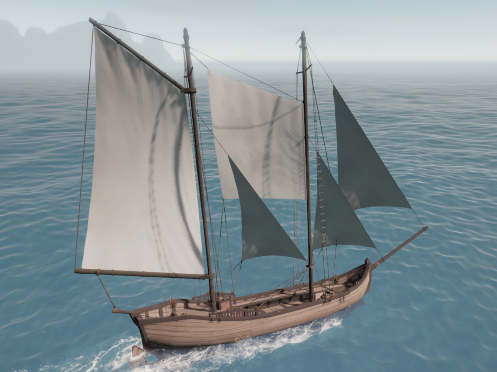</a>
  <a href="images/chronian-fishermans-staysail.png">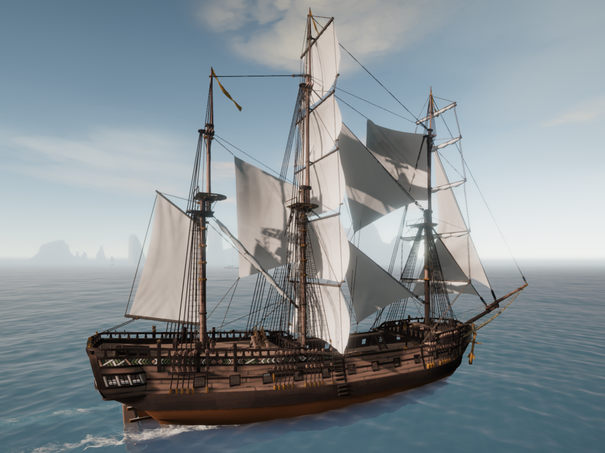</a>
  <a href="images/shroud-fishermans-sails.png">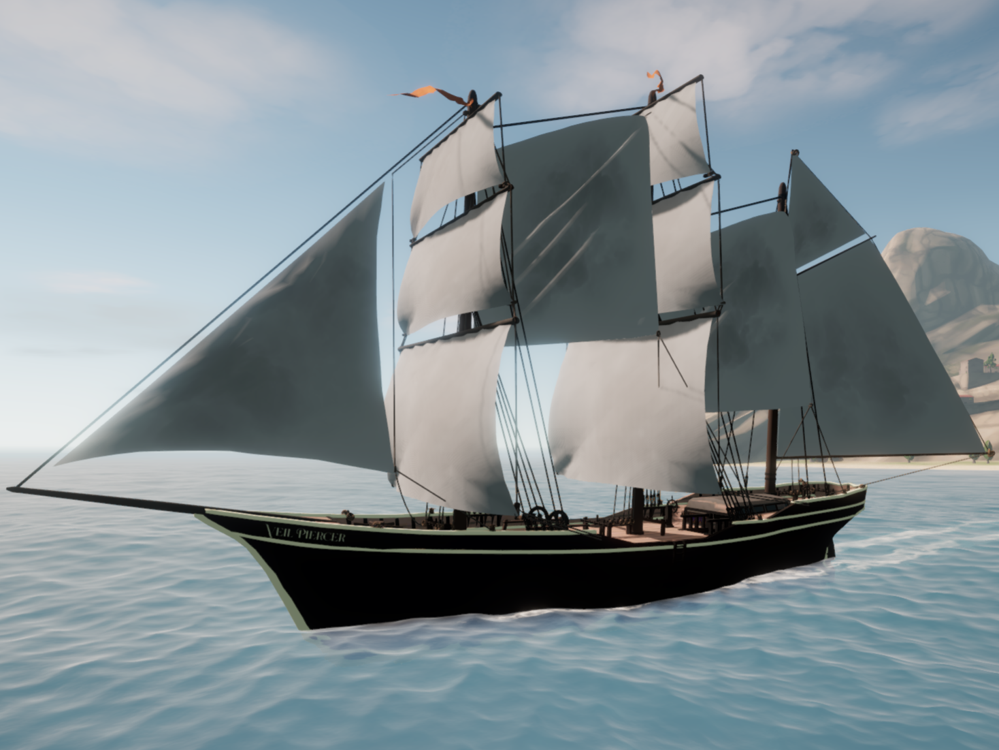</a>
   
  <a href="images/caelanor-fishermans-staysail.png">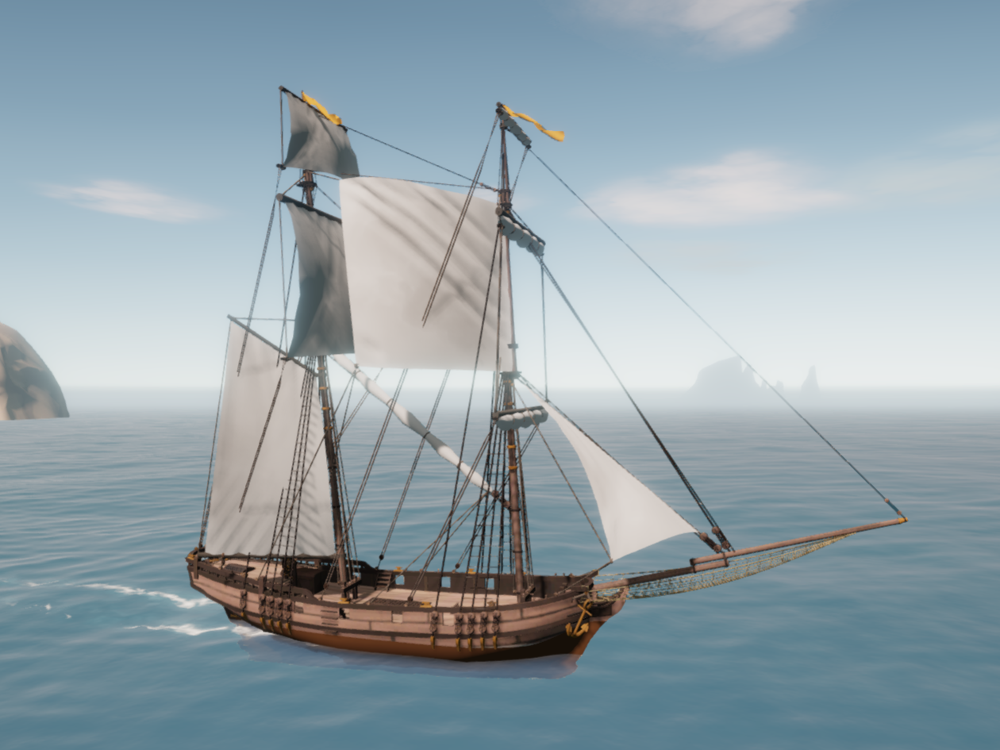</a>
  <a href="images/sailinfo-staysail-halyard-label.png">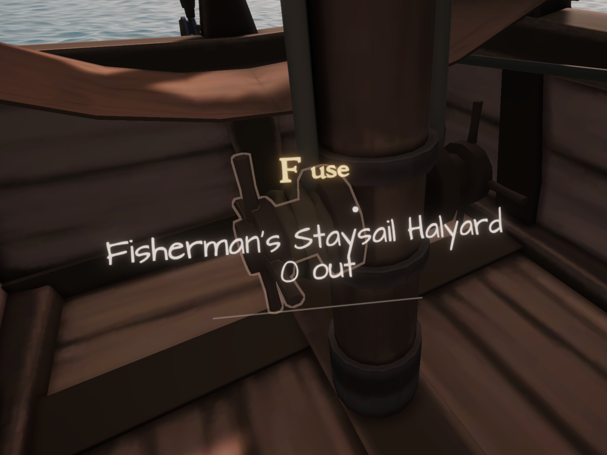</a>
  <a href="images/fishermans-staysail-at-sea.png">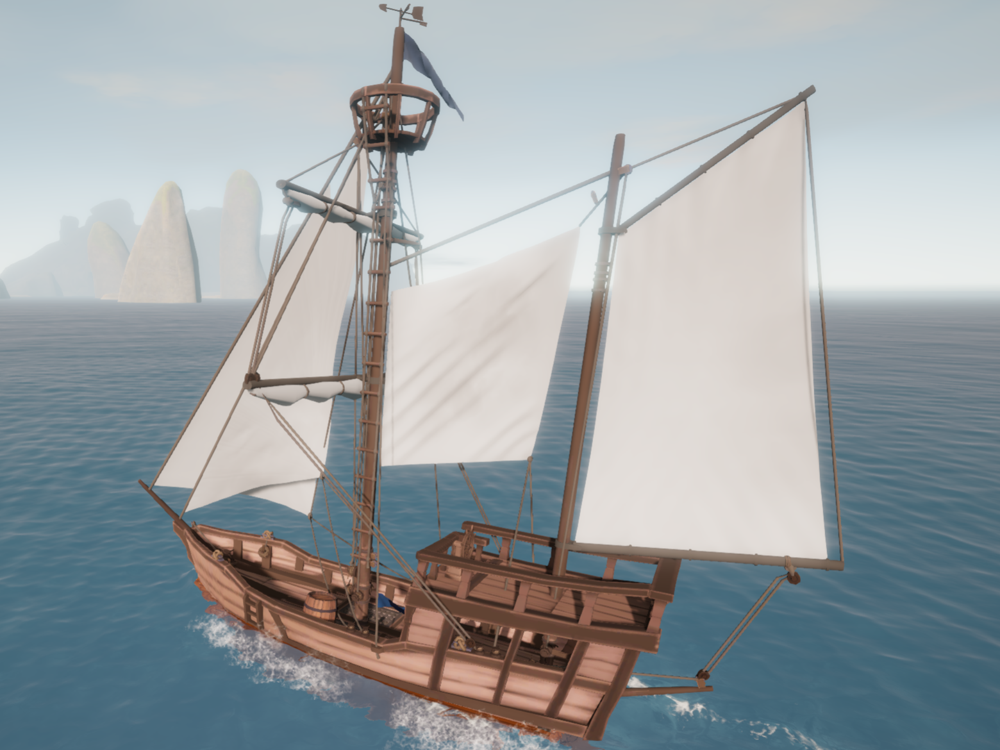</a>

### Supported boats

Flying Sails and Fisherman's Staysails support the boats below. Available
fittings depend on your installed mods and chosen masts; not every mast
combination supports a sail or stay.

| Boats                                 | Requirements and fitting notes                                                                               |
| ------------------------------------- | ------------------------------------------------------------------------------------------------------------ |
| **Brig, Junk, Jong, Sanbuq, Baghala** | Stay options are available with the base game. Shipyard Expansion adds more mast combinations on some boats. |
| **Cog, Kakam, Dhow**                  | Current Fisherman's Stay options require parts supplied by Shipyard Expansion.                               |
| **Shroud**                            | Requires [Shattered Seas Expansion](https://github.com/TheOriginOfAllEvil/Shattered-Seas-Expansion).         |
| **Gloriana, Chronian, Caelanor**      | Requires OldChronian; support targets version 0.6.0.                                                         |

**Fisherman's sails do not support Leopard yet.** Future Leopard compatibility
for Fisherman's sails is tracked in
[issue #33](https://github.com/sum-rock/MoreSailwindSails/issues/33).

### Fitting a staysail

1. Open the shipyard's **Stays** and select **Fisherman's Stay** for the mast
   pair you want to use.
2. Choose the variant matching your fitted masts and topmasts.
3. Select that stay in the sail-fitting controls, open **Staysails**, and choose
   a **Fisherman's Staysail**.

**Fisherman's Staysails can only be fitted to Fisherman's Stays.** Each stay
carries one sail; these stays can also carry vanilla staysails. Staysails can
coexist with square sails on their forward physical mast, including its topmast
sections.

### Using the Flying Sail

At a shipyard, select a **physical mast**, open **Other**, and choose
**Fisherman's Flying Sail**. It needs a supported fitted mast behind it.

## Spritsail

Loose Footed Spritsails are boomless sails supported by a diagonal wooden spar.
Mk.A and Mk.B have only the mainsail portion. Mk.C and Mk.D have both a mainsail
and topsail.

  <a href="images/baghala-spritsail.png">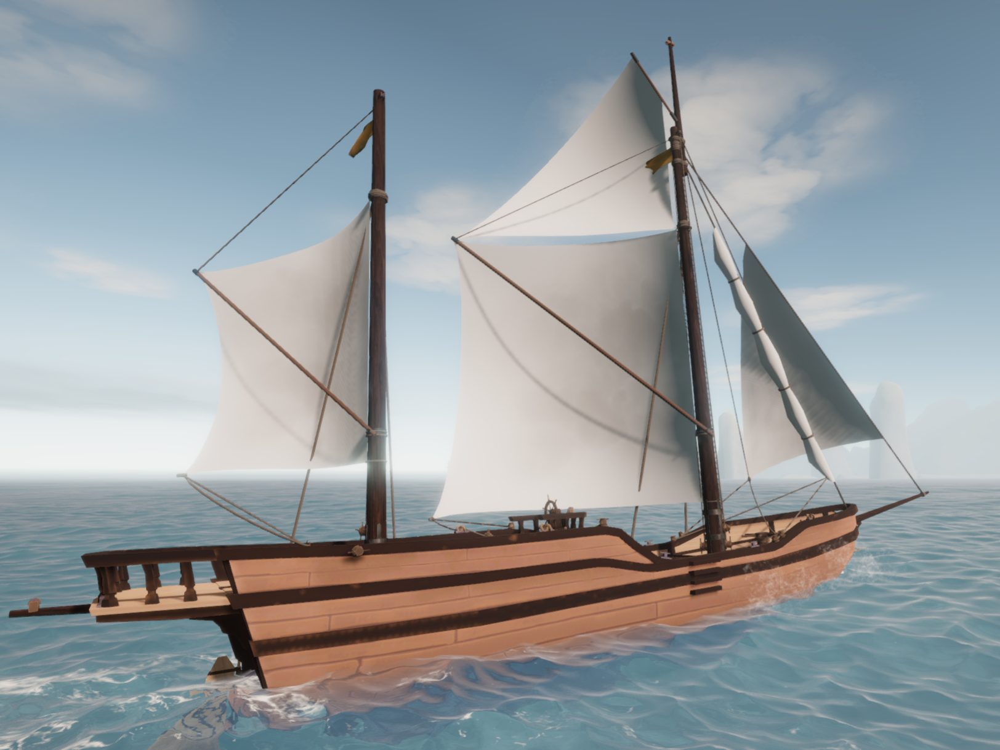</a>
  <a href="images/cog-spritsail.png">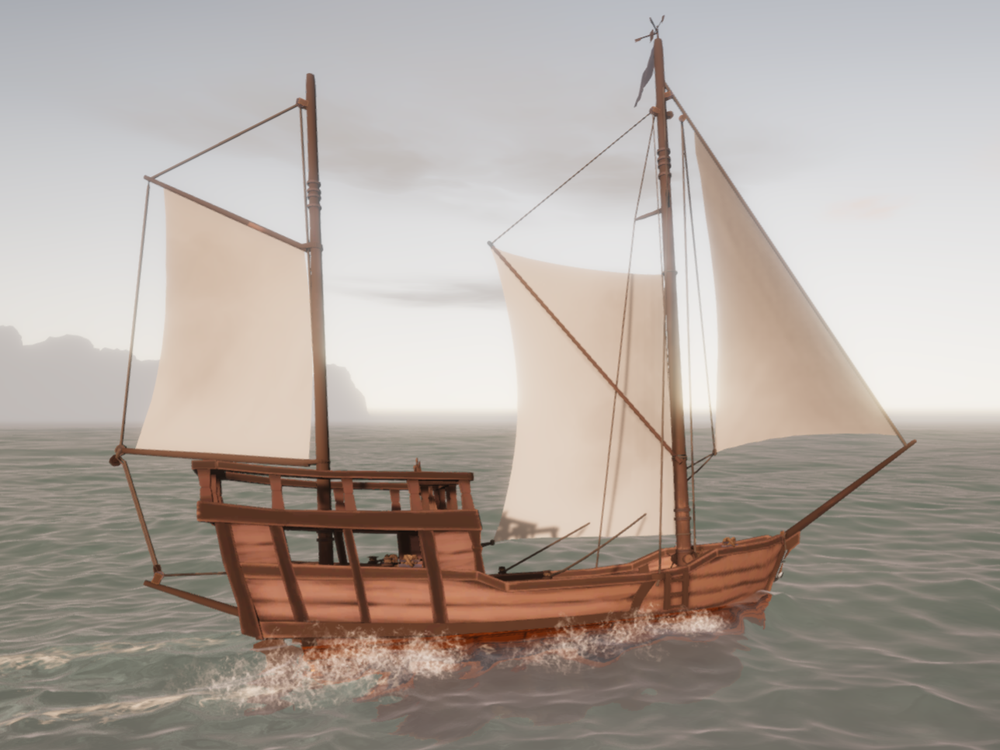</a>
  <a href="images/junk-spritsail.png">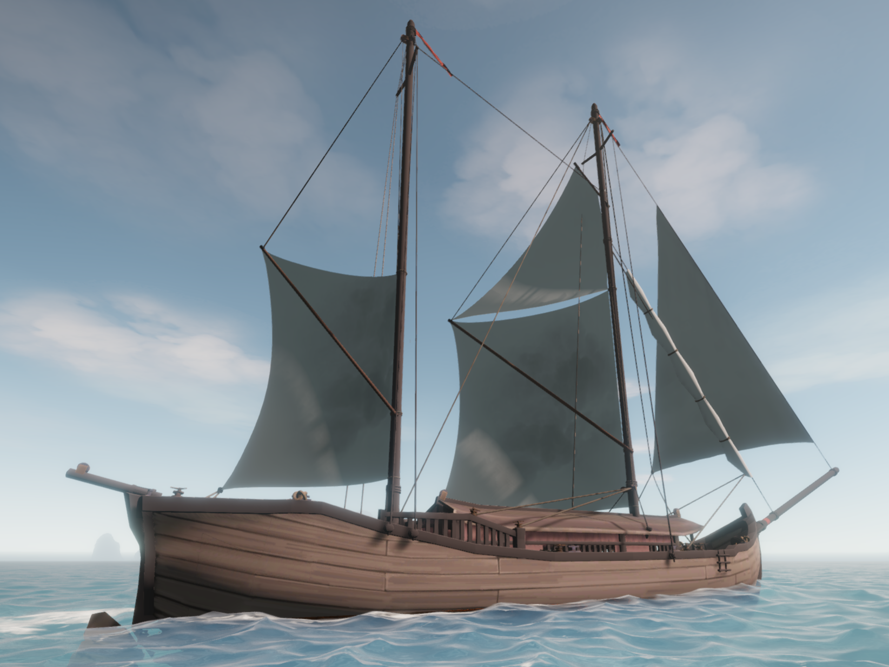</a>
   
  <a href="images/kakam-spritsail.png">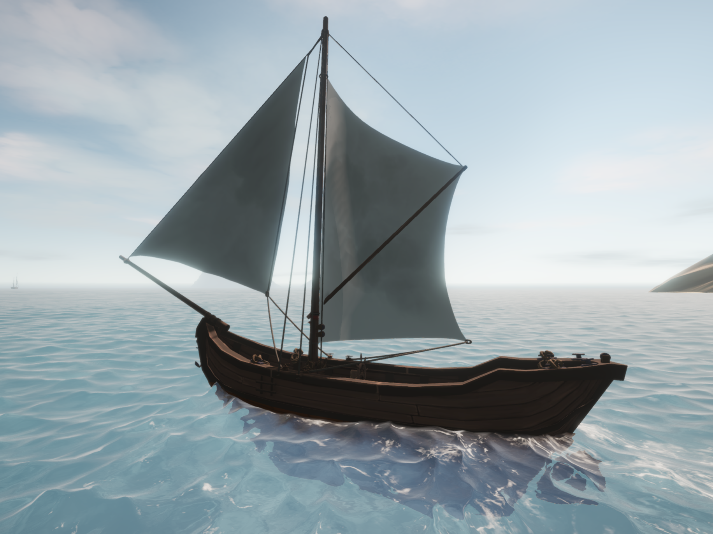</a>
  <a href="images/brig-spritsail.png">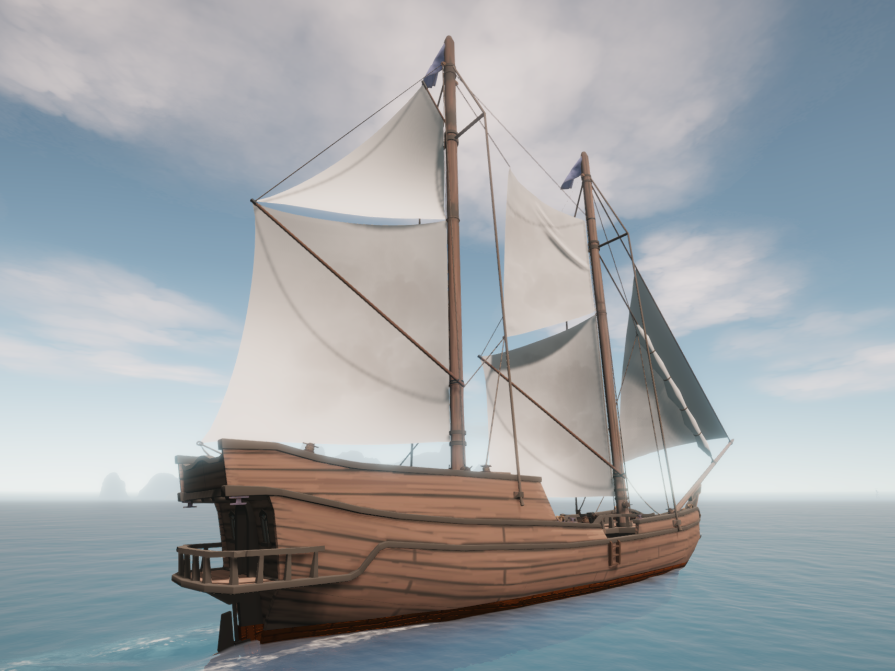</a>
  <a href="images/sanbuq-spritsail.png">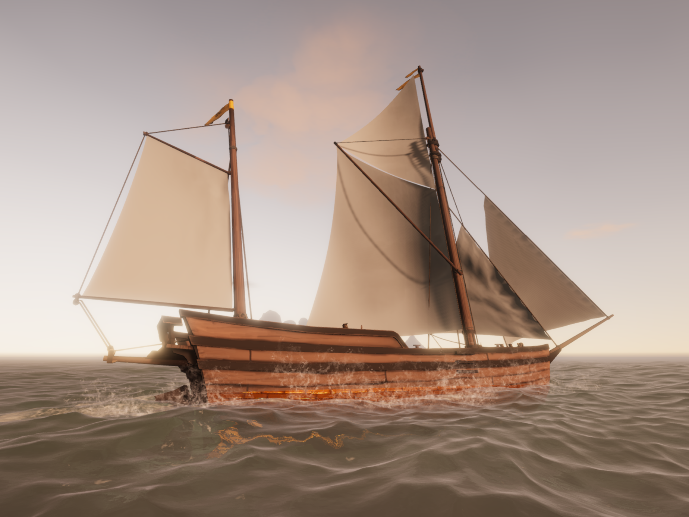</a>

### Bad tack

Spritsails have a "bad tack" that incurs a 10% force penalty. This occurs when
the sprit is leeward of the mast and interferes with the sail's billowing.

When sailing on the bad tack, a small notification appears in the bottom-right
corner of the screen for 30 seconds. To hide the notice, set
`ShowSpritsailBadTackNotice` to `false` in the `[Interface]` section of
`com.august.moresailwindsails.cfg`. Hiding it does not change sailing
performance.

### Mast and boat support

Loose Footed Spritsails can be installed on any mast. The fitting is similar to
native gaff sails; it depends on enough room for the sail and available winch
positions.

On all native boats and some modded boats, cuts with a topsail can span both the
lower mast and topmast. The topsail sits on the topmast, while the mainsail
portion of the same sail sits on the lower mast.

### Fitting a spritsail

1. At a shipyard, select the **mast** you want to use and open **Other**.
2. Choose a **Loose Footed Spritsail**. Preview the cuts to choose a shape that
   suits your rig.
3. Adjust height, width and position. With Shipyard Expansion, you can flip the
   spritsail to change which tack is the bad tack.

**Topsail:** For cuts with a topsail, the topsail is hidden once the sail is 20%
reefed.

### Price and sailing performance

Spritsails cost less than gaff or junk sails of equal area: about **20% less
than a gaff** and **25% less than a junk sail**, before currency rounding.
Larger sails cost more. For Mk.C and Mk.D, the price includes the topsail.

On the favorable tack, their basic power sits between gaff and junk sails of
equal area.

## Controls (winches, belaying pins and fife rails)

By adding new sail types, this mod makes it possible for players to create sail
plans that exhaust the available mounting positions for control winches.
Fisherman's Stays in particular can cause this problem because they provide
additional sail placements that boat authors did not account for.

To make this mod work, additional locations were identified on each supported
boat where winches for sheeting or reefing could be placed. All sails in the mod
attempt to use native winch positions and fall back to these custom placements
when no native position is available. The logic here is very difficult to get
right.

**Missing control lines?**

If a player creates a sail plan with many sails, it is possible to run out of
placements for winches. When that happens, the sail's reefing or sheeting lines
hang from the clew or throat and disappear into the deck. If this happens,
submit a [GitHub issue](https://github.com/sum-rock/MoreSailwindSails/issues)
with details of the boat and sail plan so I can identify where more fallback
placements are needed.

## Requirements and installation

**Use at your own risk.** This mod is provided as-is, without warranty. I am not
responsible for damage, data loss, or other issues affecting your computer,
game, or save files from using this mod. Back up your saves before installing.

- Developed against **Sailwind 0.40.1**
- Requires **BepInEx 5**; developed against **5.4.23.5**.

**Optional mods (development versions):**

- **Shipyard Expansion 0.12.2** for additional rigging and shipyard controls.
  Starting with 0.3.0, it is no longer required to load MoreSailwindSails, but
  some boat fittings still need its parts (see
  [supported boats](#supported-boats)).
- **SailInfo 1.2.1** for control hover labels and sail information.
- **Shattered Seas Expansion 0.1.3** or **OldChronian 0.6.0** for their
  respective boats.

1. Download `MoreSailwindSails.dll` from the
   [release page](https://github.com/sum-rock/MoreSailwindSails/releases).
2. Close Sailwind.
3. Place the DLL in `<Sailwind>/BepInEx/plugins/MoreSailwindSails/`, creating
   the folder if needed.
4. When updating, replace the old DLL and remove any duplicate copies.
5. Launch the game and visit a shipyard.

### Updating

Back up your save before updating.

Existing Fisherman's sail and stay selections retain their saved identifiers.
When updating from 0.3.0, winch positions may change under the new allocation
rules. Older patterned sails use plain cloth through the supported Shipyard
Expansion texture integration.

For a bug report, include the boat, fitted masts, mod versions, steps to
reproduce, a screenshot if useful, and `BepInEx/LogOutput.log`. Submit it
through the
[issue tracker](https://github.com/sum-rock/MoreSailwindSails/issues).

## Removing the mod

Before uninstalling, remove all sails and rigging added by MoreSailwindSails
(including spritsails, Fisherman's sails and stays), then save your game. Remove
fitted sails before removing the stays or masts that support them.

## Changelog

### 4.0.0

- Added **Loose Footed Spritsails** with four variations.
- **VirtualCrew can now discover Fisherman's Stays and their fitted sails.**
  Updated sail hinge anchors to preserve correct attachment under the boat
  model.
- **Fisherman's Staysails can now share a mast with gaffs or spritsails whose
  spars cross the staysail cloth**, provided their luffs do not touch or
  overlap.
- Added **two sheet-winch fallback pairs on Brig, three on Sanbuq and two on
  Caelanor**, providing more control positions for crowded sail plans.
- Guarded native control attachment against missing or occupied winch slots,
  preserving existing sail controls while assigning Flying Sail controls.
- Fixed **SailInfo's optional winch coloring during loading** attempting to
  access unavailable winch slots for sails managed by the mod.

### 0.3.1

- **Improved winch placement** for Staysails and Flying Sails, with shared
  position reservations and native controls preferred over fallbacks.
- **Added and refined sheet and halyard fallbacks**, including base-game boat
  halyards and revised Brig, Chronian, Gloriana and Caelanor placements.
  Controls use boat-specific models and measured mounting positions.
- **Sheet fallbacks now account for sail size**, moving farther aft when needed
  as sails grow and retaining valid positions when sails shrink.
- **Staysails can now coexist with square sails on their forward mast** without
  the shipyard rejecting the combination.
- **Rebuilt Fisherman's Stay visuals** with 4 cm rope and metal collars fitted
  to mast surfaces, without inherited donor collision geometry.
- Reduced winch discovery work, temporary allocations and duplicate stay meshes.
- Added purple fallback markers, native-scale control previews and a
  `ForceSheetFallbacks` diagnostic setting.
- Consolidated developer and maintainer tools under **`mss`** and moved
  technical documentation to the local wiki.

### 0.3.0

- **Shipyard Expansion is now optional.** Supported base-game rigs can use
  Fisherman's sails and stays without it. The native shipyard gains page arrows
  for longer rigging lists; fittings that need missing mod parts stay
  unavailable.
- Added **Kakam and Dhow** support and **Gloriana, Chronian and Caelanor**
  support from OldChronian. Dhow uses one stay option for both supported
  mainmast heights.
- Added extra halyard mounting positions on **Sanbuq, Gloriana and Kakam**, and
  placed Kakam's sheet controls near the stern.
- **Flying Sail ropes now follow the game's 3D rope setting**, matching the
  rounded appearance of native ropes when enabled.
- Reworked all four sail meshes and their texture mapping. Sails use plain cloth
  with normal recoloring; SE texture selection is restricted to plain cloth to
  prevent mismatched sail patterns, including on older saved sails.
- Removed forced uniform scaling and the mod's rotation/flip restrictions on
  staysails, leaving those options to the installed shipyard controls.

Experimental spritsails developed between releases are not included in 0.3.0.

### 0.2.2

- Updated texture integration for **Shipyard Expansion 0.12.1**, fixing the
  missing-field exception that interrupted game loading.
- Requires **Shipyard Expansion 0.12.1**.

### 0.2.1

- **Completely reworked sheeting winch and halyard winch placement** for much
  more reasonable and consistent locations, using available native mounting
  points and respecting existing winch use.
- Fixed Fisherman's sail compatibility with **Shroud** from
  [Shattered Seas Expansion](https://github.com/TheOriginOfAllEvil/Shattered-Seas-Expansion),
  including sheet placement and halyard placement on its belaying pins.
- Added **SailInfo hover labels** identifying Fisherman's Flying Sails and
  Staysails when hovering over their sheet and halyard controls.
- Fixed missing halyard placements on both **Cog** mizzen variants by using
  available associated stay winches when the mast's own winch is occupied.
- Corrected floating or tilted **Fisherman's Stay collars** on **Sanbuq** and
  **Baghala**, fitting the collars around their supporting masts.
- Fixed missing **Flying Sail corner knots**.
- Added an optional **winch mounting-point overlay** to help inspect occupied
  and available locations. It is disabled by default; see the
  [diagnostic instructions](wiki/controls/Winch-placement-diagnostics.md#viewing-winch-mounting-points).
- Removed **Leopard support** pending further compatibility work.

### 0.2.0

- **Staysail Mk.C**, with a longer luff and a foot rising toward the aft mast.
- A smaller **Flying Sail** with a trapezoid cut, fixed mast ties, rounded
  billow, revised control ropes and corner knots.
- Corrected sheet-winch placement along measured rails and other solid supports.
- Support for new Baghala and a fix for custom sail sound initialization.

For building the mod, technical details and testing notes, see the
[Developer Guide](wiki/developer-guide/Building-and-contributing.md).
